# Community Tapeout Project Proposal and Design Report

Every block is built from the RTL and pin plans of `20f8422` on PDK `v1.10.103`.

| Stage | Tools | Build date |
|---|---|---|
| Synthesis | Yosys 0.68 (`38e001a`) inside ECC | as physical |
| Physical | ECC `main` `14be467` with local edits, one run per tile type and one for `eFPGA_top`; OpenROAD `dcf3613` repairs before routing | 2026-10-27 `SW_term`, `eFPGA_top`; 2026-10-20 `LUT4x8_ha`, `MACC`, `E_IO`, `S_term`, `S_term_MACC`; 2026-10-19 `W_term`, `N_term`; 2026-10-17 the other four |
| Signoff | ECC DRC, iLVS and iSTA, with full-chip OpenSTA where stated | as physical |

## Submission Information

| Item | Details |
|---|---|
| Project name | FABulous eFPGA |
| Project lead | King Lok (Kelvin) Chung, kelvin.chung@manchester.ac.uk |
| Contributors | [Names and responsibilities] |
| Source repository | `github.com/KelvinChung2000/demo-ics55`, branch `master`; RTL, builds and simulations at `20f8422`, chip-level netlist and constraints at `c680d08`, report and appendix at the head |
| Tapeout run | MPW |
| Process and PDK | ICS55 (55 nm), ECOS PDK `v1.10.103` (`2d72857`), standard cells `ics55_LLSC_H7C_V1p10C100` (`H7CR` and `H7CL`) |
| Report version | v3.0, describing IP v4.0 (Section 4.8) |
| Submission date | [YYYY-MM-DD] |
| Current project stage | Pre-tapeout |

## 1. Project Overview

### 1.1 Project Summary

The design is a FABulous eFPGA. Its array `eFPGA` abuts 151 hard tiles of 12 types in a 13 × 12 grid of 947.0 × 884.8 µm. The top level `eFPGA_top` adds the configuration controller in 999.0 × 912.6 µm and takes 26 pads, 22 signal and 4 supply.

ECC hardens each tile type once to a routed macro. Abutment connects the 31,760 tile-to-tile nets through coincident pins, so the `eFPGA_top` run routes only the 3,442 nets of the controller, IO and configuration buses. An RTL bitstream simulation runs a counter on the fabric. A zero-delay gate-level simulation of the hardened netlists repeats it from the chip pads (Section 5.3). A chip-level netlist joins `eFPGA_top` to 22 `P65_1233_PBMUX` pads, with an SDC that times the configuration ports through them (Section 2.3).

### 1.2 Main Features

| Feature | Description | Implemented in this tapeout? |
|---|---|---|
| Logic cells | 800 `FABULOUS_LC`, 8 per `LUT4x8_ha` tile, each a LUT4 with flip-flop and carry chain | Yes |
| Hard multiply-accumulate | 5 `MACC_8x8_20`, 8 × 8 multiply into a 20-bit accumulator with carry in and out, one per two core rows | Yes |
| User IO | 10 bidirectional bits on `A_IN_top`, `A_EN_top` and `A_OUT_top`, one per `E_IO` tile on the east edge | Yes |
| Global clock network | 4 `GBUF` global clocks in `SW_term`, each selecting the `USER_CLK` pad, the `USER_RESET` pad or fabric routing, buffered at every tile hop (Section 2.5) | Yes |
| Frame-based configuration | 69,746 configuration latches (synthesis) written one frame at a time (Section 2.2) | Yes, all 12 rows including the two terminator rows |
| Full and partial reconfiguration | A partial bitstream writes any subset of frames while the rest of the fabric keeps running | Yes by construction of the frame addressing; not yet demonstrated in simulation |
| Configuration controller | `fabric_config` (fabulous-fabrics `7223ee9`) behind `config_frontend`, of whose loaders UART and SPI reach a pin | Yes, hardened in `eFPGA_top` |

### 1.3 Design Highlights and Use Cases (Optional)

The fabric reaches 955 logic cells per mm² of array (95.5% core utilisation) and 877 per mm² of `eFPGA_top`. Configuration and routing set this density, since on one `LUT4x8_ha` the 614 configuration latches take 39.6% of the die and the 345 `MUX4` plus 32 `MUX2` switches 33.3%. Abutment caps the largest tile run at 3,777 instances (`MACC`) and the top run at 3,404 standard cells around 151 fixed macros, against 238,572 instances flat.

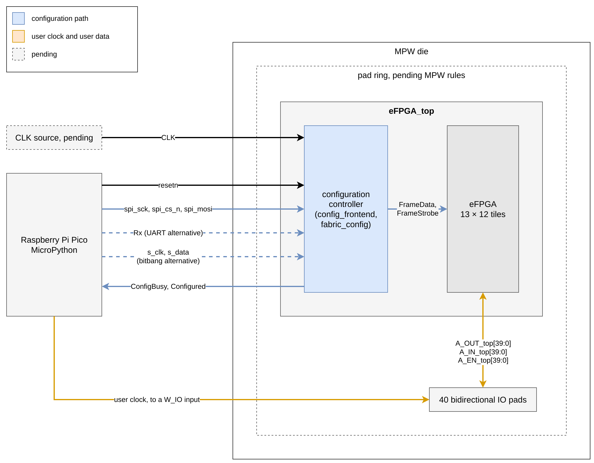

**Figure 1-1. Application scenario, with a Raspberry Pi Pico loading the bitstream and clocking the fabric.**

## 2. Design Description

### 2.1 System Architecture

`fabrics/nobram/fabric.csv` sets the grid below. `flow cli integrate` (`flow/topwrap.py`) flattens it with the configuration logic into `build/nobram/top/rtl/eFPGA_top.v`, a netlist of 151 tile macros with the ports of the hierarchical `fabrics/nobram/Fabric/eFPGA_top.v`.

| Column | Width (µm) | Tile types, top to bottom |
|---|---:|---|
| 0 | 28.8 | `NW_term`, `W_term` × 10, `SW_term` |
| 1 to 5 | 82.6 each | `N_term`, `LUT4x8_ha` × 10, `S_term` |
| 6 | 70.8 | `N_term_MACC`, `MACC` supertile × 5, `S_term_MACC` |
| 7 to 11 | 82.6 each | `N_term`, `LUT4x8_ha` × 10, `S_term` |
| 12 | 21.4 | `NE_term`, `E_IO` × 10, `SE_term` |

Core rows are 84.0 µm high and terminator rows 22.4 µm. Routing wires of span 1, 2, 4 and 6 cross each seam. `FrameData` (384 bits, 32 per row) enters on the west edge and `FrameStrobe` (260 bits, 20 per column) on the south edge.

The tiles are the classic library of `FPGA-Research/fabulous-tiles` at `5809cdf` with the FABulous BELs `FABULOUS_LC`, `MACC_8x8_20`, `IOBUF`, `GBUF` and `SYS_RESET`, plus this project's `USER_CLK` pad BEL in `SW_term`. No other third-party IP is instantiated (Section 11.2). `W_term`, `N_term` and `S_term` are the library's `W_IO`, `N_IO` and `S_IO` without the `IOBUF` BEL, on unchanged dies so every seam pin stays in place.

In `eFPGA_top` the controller occupies a 48 µm west channel and a 22.4 µm south strip. The array's lower-left corner sits at (50.0, 24.6) µm, one 1.4 µm row above the strip.

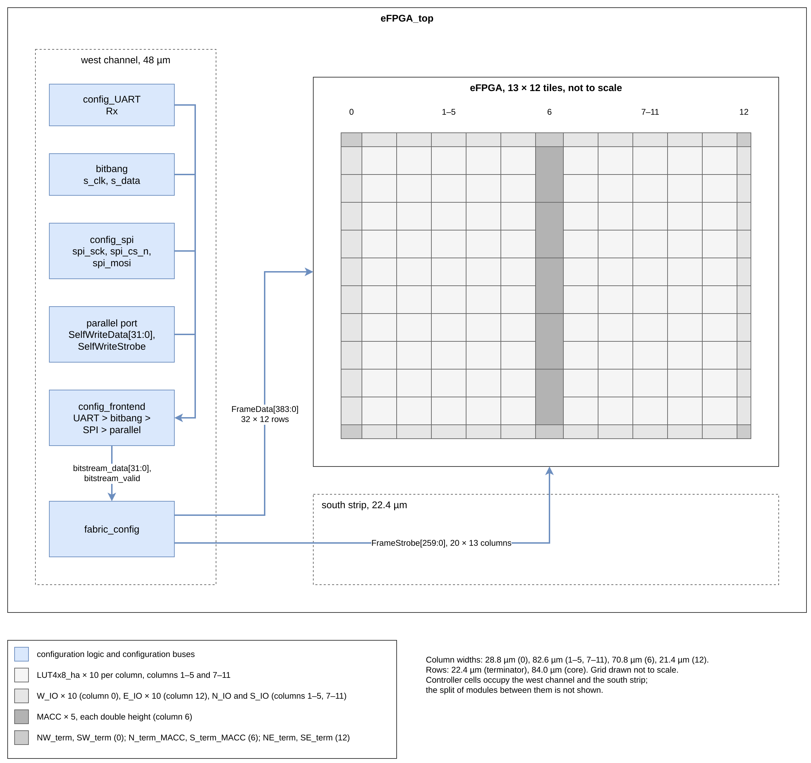

**Figure 2-1. System architecture, configuration path (not to scale).**

### 2.2 Operation

After `resetn` is released a host streams 32-bit words into the UART or SPI loader of `config_frontend`, which gives UART priority over SPI. `flow/topwrap.py` ties the bitbang inputs and the 32-bit parallel input low, since their 35 pins exceed the pad budget. `fabric_config` decodes the stream (Section 2.4) and pulses the `FrameStrobe` of the addressed frame, whose latches capture `FrameData`.

A frame is 32 bits in every row of one column. Each tile holds up to 20 frames (640 bits), of which `LUT4x8_ha` uses 614. A partial bitstream carries only the changed frames while the rest of the fabric keeps running on the separate user clock (Section 2.5). Latches are transparent during `FrameStrobe`, so the user design must hold a rewritten region idle or in reset.

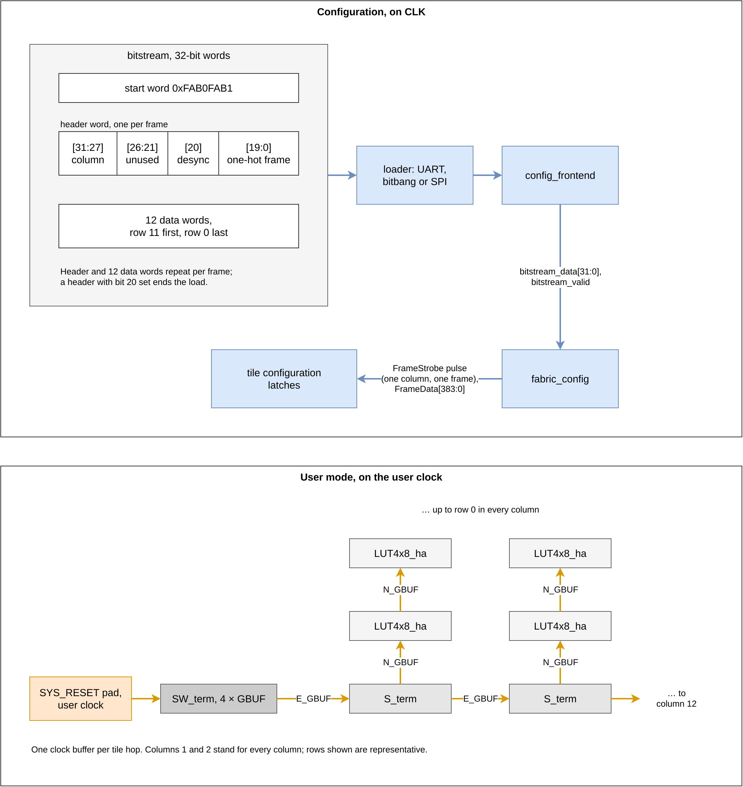

**Figure 2-2. Configuration and user-mode phases.**

### 2.3 Interface and Port Definitions

The ports below come from `fabrics/nobram/Fabric/eFPGA_top.v` and the loader sources in `Fabric/`. The hardened macro carries each bit as a scalar pin, `A_IN_top_0` to `A_IN_top_9` and so on. The RTL specifies no reset states.

| Port name | Direction | Width | Clock domain | Active level | Reset state | Description |
|---|---|---:|---|---|---|---|
| `A_OUT_top` | in | 10 | user (fabric) | High | N/A | Pad-to-fabric data, one bit per `E_IO` tile |
| `A_IN_top` | out | 10 | user (fabric) | High | N/A | Fabric-to-pad data |
| `A_EN_top` | out | 10 | user (fabric) | High | N/A | Output enable per IO bit, not gated by `Configured` |
| `USER_CLK` | in | 1 | user (fabric) | Rising edge unless the `GBUF` inverts it | N/A | User clock pad, input 9 of each of the four `GBUF` input multiplexers |
| `USER_RESET` | in | 1 | user (fabric) | Set by the user design | N/A | User reset pad (`SYS_RESET` BEL), input 8 of each `GBUF` input multiplexer, reaching the logic cells' `GSR` through a `GBUF` |
| `CLK` | in | 1 | `CLK` | Rising edge | N/A | Configuration logic clock; does not clock the fabric |
| `resetn` | in | 1 | `CLK` | Low | N/A | Configuration reset; synchronous in `fabric_config`, asynchronous in the UART and SPI loaders |
| `Rx` | in | 1 | `CLK` (sampled) | N/A | N/A | UART bitstream input; one bit lasts `ComRate` + 1 = 218 `CLK` cycles |
| `ComActive` | out | 1 | `CLK` | High | N/A | UART reception in progress |
| `ReceiveLED` | out | 1 | `CLK` | High | N/A | Toggles on UART or SPI activity |
| `spi_sck`, `spi_cs_n`, `spi_mosi` | in | 1 each | `CLK` (sampled) | `spi_cs_n` low | N/A | SPI mode-0 write-only slave, no MISO |
| `ConfigBusy` | out | 1 | `CLK` | High | N/A | `fabric_config` is out of idle |
| `Configured` | out | 1 | `CLK` | High | N/A | Cleared by the start word, set by the desync header |

One `P65_1233_PBMUX` bidirectional pad joins the three macro pins of each user IO bit, so the 42 signal pins take 22 signal pads, 10 bidirectional, 8 input and 4 output, beside four supply pads.

| Pad | Type | `eFPGA_top` pins | Function |
|---|---|---|---|
| `PAD_IO[0]` to `PAD_IO[9]` | bidirectional | `A_OUT_top_i`, `A_IN_top_i`, `A_EN_top_i` | User IO on `E_IO` X12Y10 (`PAD_IO[0]`, bottom of the east edge) to X12Y1 (`PAD_IO[9]`, top); `A_EN_top_i` drives the pad's OE |
| `PAD_CLK`, `PAD_USER_CLK` | input | `CLK`, `USER_CLK` | Configuration and user clocks |
| `PAD_USER_RESET` | input | `USER_RESET` | User reset |
| `PAD_RSTN`, `PAD_SPI_CSN` | input, pull-up | `resetn`, `spi_cs_n` | Held inactive while the pad floats |
| `PAD_SPI_SCK`, `PAD_SPI_MOSI`, `PAD_UART_RX` | input | `spi_sck`, `spi_mosi`, `Rx` | Bitstream loaders |
| `PAD_UART_ACTIVE`, `PAD_CFG_LED`, `PAD_CFG_BUSY`, `PAD_CFG_DONE` | output | `ComActive`, `ReceiveLED`, `ConfigBusy`, `Configured` | Status |
| VDD | supply | `vdd_stripe_generate` | Core supply |
| VSS | ground | `vss_stripe_generate` | Core ground |
| VDDIO | supply | none | Pad-ring supply |
| VSSIO | ground | none | Pad-ring ground |

`python3 -m flow.cli --variant nobram chip-top` (`flow/chiptop.py`) writes this ring as `build/nobram/chip/top.v` from the ICS55 IO library `ICsprout_55LLULP1233_IO_251013`. It reads the macro pins from `eFPGA_top_Harden.lib` through Yosys and refuses a pin it cannot place. Every pad drives 16 mA (DS0 = DS1 = 0) with a Schmitt input (CS = 0) and no pull-down. The OpenECOS team places the signal and supply pads. Package pins are unassigned.

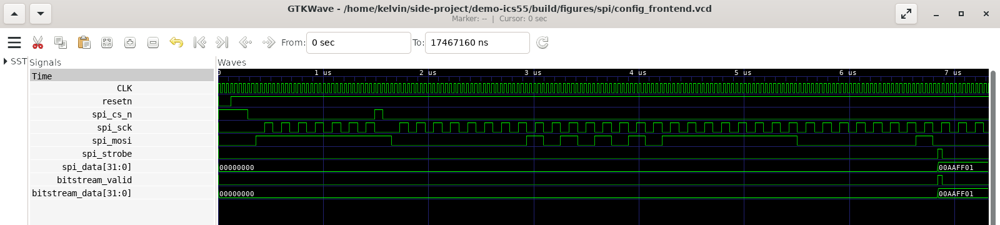

**Figure 2-3. SPI loader (mode 0, MSB first) at 25 MHz `CLK` in the cocotb SPI test. One 32-bit `spi_cs_n` frame yields `bitstream_valid` with `0x00AAFF01`, the first word of a `.bit` file.**

### 2.4 Register or Command Definitions (Optional)

The fabric has no memory-mapped registers. It takes a FABulous bitstream of 32-bit words, decoded as below by the loader and `fabric_config` sources in `Fabric/`.

| Address/Command | Name | Access | Reset value | Bit-field definition | Access side effects |
|---|---|---|---|---|---|
| `00 AA FF` + command byte | UART header | W | N/A | Command bit 7 selects hex (1) or binary (0) mode in the default auto mode | Starts a UART load; `ComActive` goes high |
| `0xFAB0_FAB1` | Start word | W | N/A | Fixed pattern | Moves `fabric_config` from idle to header; clears `Configured`; `ConfigBusy` goes high |
| Header word | Frame select | W | N/A | Bits [19:0] one-hot frame, bits [31:27] column, bit 20 desync flag | Selects one frame in one column; the next 12 words are its data |
| Frame data words | Frame data | W | N/A | 32 configuration bits for one row, row 11 first and row 0 last | After the 12th word the column's `FrameStrobe` pulses and the latches capture the frame |
| Header with bit 20 set | Desync | W | N/A | Bit 20 set | Returns `fabric_config` to idle, sets `Configured`, ends configuration |
| SPI word | SPI data | W | N/A | 32 bits shifted in on `spi_sck` rising edges while `spi_cs_n` is low | Each complete word enters the stream |

Because of the FABulous header `00AAFF01000000010000000000000000FAB0FAB1`, a `.bit` file loads unchanged over UART in binary mode or word by word over SPI.

### 2.5 Clocks and Resets

`CLK` clocks the configuration logic only and is constrained at 10 ns (100 MHz, `fabric.frequency_mhz` in `Fabric/ecc_config.toml`). The UART divisor `ComRate` keeps its default 217, set for 115,200 baud at 25 MHz, so at 100 MHz the UART runs at 458,716 baud and needs `ComRate` = 867 for 115,200. SPI oversamples `spi_sck` on `CLK` and needs `CLK` above twice `spi_sck`, with four times recommended (`Fabric/config_spi.v`).

With `DisableUserCLK` set in `fabric.csv` the fabric has no clock port, so the user clock enters on the `USER_CLK` pad. Its `USER_CLK` BEL in `SW_term` drives only input 9 of each of the four `GBUF` input multiplexers. The `SYS_RESET` BEL drives input 8 from the `USER_RESET` pad. Fabric routing reaches the other inputs through the `S_term` and `W_term` feed wires, giving up to four global nets. Each `GBUF` drives `E_GBUF` wires along the bottom row and `N_GBUF` wires up every column, buffered at every tile hop. A user design takes its reset into the logic cells' `GSR` through a `GBUF`, as `submission/test/user_design/top_wrapper.v` does on `GBUF` B.

Minimum reset duration, reset release requirements and power-up sequencing are not specified. `resetn` has no deassertion synchroniser. The configuration latches have no reset, so from power-up until configuration ends each `A_EN_top` bit follows whatever its latches hold and its pad may drive. [to be taken from `fabric_config` and the MPW board's reset circuit].

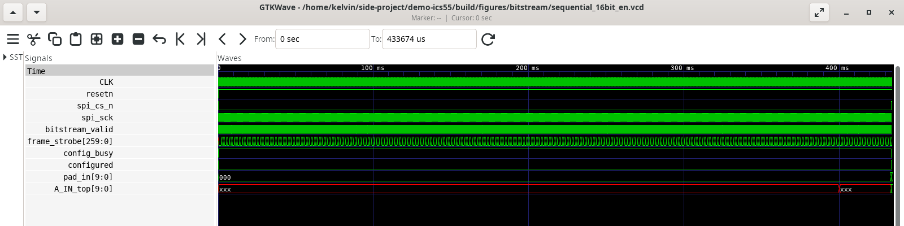

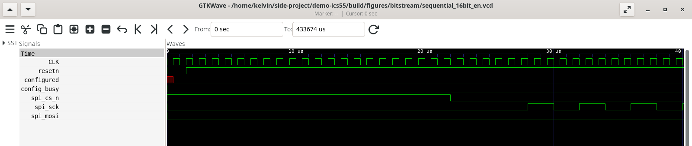

**Figure 2-4. Bitstream simulation. Top, the whole 433.7 ms run, with `frame_strobe` pulsing while `config_busy` is high. Bottom, the first 40 µs, from reset release to the start of SPI.**

### 2.6 Device Programming

Programming will reuse the bring-up flow of the wafer.space gf180mcu FABulous FPGA, `github.com/mole99/wsrun1-fpga-bringup` (`81a9a99`, Apache-2.0), once the MPW package and test board are known. That flow compiles with Yosys `synth_fabulous`, `nextpnr-generic --uarch fabulous` and the FABulous bitstream generator, then loads from an RP2040 Raspberry Pi Pico on MicroPython. Its `Makefile` flow, bitstream format, Pico file layout and test designs (`counter`, `passthrough`, `all_ones`, `all_zeros`) carry over. The protocol is unchanged.

| Part replaced | Replacement for this fabric |
|---|---|
| nextpnr model and bitstream specification | `fabrics/nobram/.FABulous/` (`pips.txt`, `bel.v2.txt`, `bitStreamSpec.bin`) |
| IO constraints (written) | `submission/test/user_design/pads.pcf` on the 10 `IOBUF` BELs, `iobuf_map.v` for the `-iopad` cells, clock through `USER_CLK` at `X0Y11.F` into `GBUF` A and reset through `SYS_RESET` at `X0Y11.E` into `GBUF` B as in `top_wrapper.v` |
| Techmaps | Without the register-file and SRAM mappings |
| Pico upload pins | `spi_cs_n`, `spi_sck`, `spi_mosi`, with `ConfigBusy` and `Configured` as status, in place of gf180's `FPGA_MODE`, `FPGA_BUSY`, `CS_N`, `SCLK`, `MOSI` |
| Pico pin assignment | Depends on the MPW test board |

## 3. Design Targets and Results

### 3.1 Functional Metrics

| Metric | Target | Latest result | Measurement or verification method |
|---|---:|---:|---|
| Logic cells | 800 | 800 | Physical: 100 `LUT4x8_ha` × 8 |
| Multiply-accumulate blocks | 5 | 5 | Physical: 5 `MACC` supertiles |
| User IO | 10 | 10 | RTL: `A_*_top[9:0]` |
| Global clocks | 4 | 4 | RTL: `GBUF_A` to `GBUF_D` in `SW_term` |
| Seam connectivity | all declared links meet | 31,760 of 31,760 links over 282 seams | `task check` on `build/nobram/fabric_plan.json`; the `eFPGA_top` DEF holds the same 31,760 nets (Section 7) |
| Configuration reaches every row | all 12 rows | 384 of 384 `FrameData` and 260 of 260 `FrameStrobe` bits routed | Routed DEF. Simulation shows rows 1 to 8 and 11 configured (Section 5.3). No simulated design observes row 0. |
| User design on the fabric | runs a test design | 123 of 123 compares match on all 10 IO bits, 23 of them after a `USER_RESET` pulse | Section 5.3 |

### 3.2 Performance, Resource, and Power Metrics

| Metric | Target | Latest result | Conditions |
|---|---:|---:|---|
| Configuration clock | 100 MHz | Met at all six corners; worst setup slack +6.229 ns, +4.494 ns through the pads | Full-chip OpenSTA at ss 1.08 V 125 °C Cworst; the pad figure is chip-level STA at that corner only (Section 6.3) |
| User-mode operating frequency | [Target] | Pending, unmeasured | No routed user design has been timed (Section 6.3) |
| Processing latency | Not applicable | Not applicable | Set by the configured user design |
| Throughput | Not applicable | Not applicable | Set by the configured user design |
| Standard-cell count/area | ≤ 1 mm² footprint | 911,687 µm² `eFPGA_top`; synthesis 179,772 cells, 682,405 µm² | Breakdown in Sections 6.1 and 6.2 |
| SRAM/ROM/macro resources | none | none | No hard macro in the fabric |
| Power | Not applicable | Not reported | Not assessed for this submission |

## 4. IP Reuse and Standardization

### 4.1 Reuse Objectives and Use Cases

- [ ] Shared infrastructure within an MPC, or a reusable module for designs submitted through an MPW shuttle, such as standard I/O, clock and reset, configuration, test, or bus-connectivity logic.
- [ ] An interface controller between a user design, shared platform infrastructure, and chip-level I/O, providing protocol conversion, register access, or control functions.
- [x] A standalone digital IP block, hard macro, logic tile, programmable fabric, accelerator, processor, or peripheral.
- [ ] A design intended only for validation in this tapeout, with no current plan for reuse across projects.

Another project can take the hardened `eFPGA_top`, the abutted `eFPGA` array with its own controller or the 12 tile types abutted into a different grid (interface in Section 4.4). A new grid in `fabrics/nobram/fabric.csv` keeps one width per column and one height per row. It needs `eFPGA.v` and each `io_pin_order.yaml` regenerated through FABulous and the Section 4.6 flow re-run, but no tile re-hardened unless a die changes.

### 4.2 Supported Reuse Levels

| Reuse level | Supported? | Deliverables or limitations |
|---|---|---|
| RTL-level reuse | Yes | `fabrics/nobram/Fabric/`, `Tile/`, `primitives/`. Regenerating the Verilog byte-identically needs FABulous `c0ca476` (`user-clk-attr`), while `io_pin_order.yaml` needs `092f606` (`fix-direction`). Neither checkout produces both. |
| Post-synthesis netlist reuse | Yes, per tile and for `eFPGA_top` | `build/nobram/tiles/<type>/`, `build/nobram/top/` |
| Hard-macro reuse | Per tile and `eFPGA_top` | Abstract LEF, Liberty, routed DEF, netlist, SPEF at nine RC corners and abstract GDS for each tile and for `eFPGA_top` (LEF 999.0 × 912.6 µm with 44 pins, in `build/nobram/top/default/Harden_ecc/output/`). ECC's `eFPGA_top` Liberty holds only 2 zero-delay arcs, so chip-level STA reads the extracted model `build/nobram/chip/etm/eFPGA_top_ss_125_Cworst.lib` instead. |
| Tile/fabric-level reuse | Yes | `build/nobram/fabric_plan.json` holds every die, pin offset and seam |
| MPW top-level integration | Partly | Pad netlist `build/nobram/chip/top.v` and constraints `top.sdc` (Section 2.3). No pad placement, seal ring or chip-level GDS. |

### 4.3 IP Baseline Specification

| Category | Required information |
|---|---|
| Process environment | As in Submission Information, technology LEF `N551P6M_ecos.lef`. ECC STA runs 13 corners over tt 1.2 V 25 °C, ss 1.08 V and ff 1.32 V at 125 °C and −40 °C. |
| Physical dimensions | Section 6.2; array aspect 1.07. Tile edges lie on the 0.2 µm `core7` site and the 2.8 µm row grid. |
| Resource capacity | 800 `FABULOUS_LC`, 1,110 tile flip-flops, 5 `MACC_8x8_20`, 4 `GBUF`, 10 IO, no SRAM, ROM or PLL |
| Clocks and resets | Section 2.5 |
| Functional interfaces | Section 2.3 |
| I/O and pins | 42 signal and two supply pins mapped to 26 pads (Section 2.3). Tile east and west pins on MET3 at 0.6 µm minimum pitch, north and south on MET4 at 0.4 µm, on the 0.2 µm track grid, ordered by each tile's `io_pin_order.yaml`. |
| Power and PDN | `VDD` and `VSS`, nominal 1.2 V. Per tile MET1 follow-pin rails, MET4 vertical and MET5 horizontal stripes, VDD and VSS alternating every 8.4 µm to the die edge, joined by abutment. `eFPGA_top` adds PDN only over the channel and strip (113 strip and 6 channel MET4 stripes, 3 strip and 104 channel MET5 stripes, 650 MET1 rails). |
| Physical constraints | MET1 to MET5; the top run blocks routing over the array. Orientation R0 only. No DRC or antenna waivers claimed. |
| Metrics and operating conditions | Section 3.2 |
| Portability | ICS55-specific are the netlists, the tile dies and `techmap/ics55_models.v`; the RTL and `fabric.csv` are PDK-independent |

### 4.4 Standard Interfaces and Integration

1. A user design reaches the fabric through its 10 IO bits. The fabric is configured from a host over SPI or UART, not through a bus.
2. Not applicable, since the fabric is not an interface controller. Both loaders sample their inputs, `spi_sck` included, on `CLK`.
3. The top level provides `CLK`, `resetn`, at least one loader, the 10 IO bits, a user clock on `USER_CLK` and a user reset on `USER_RESET`. Unused loader inputs are tied to their idle level.
4. Used as a block, `eFPGA_top` fixes its die, its 42 signal pin positions and its power stripes. Re-abutted tiles fix every die, edge pin order and offset, the signal layers (MET3 east and west, MET4 north and south), the PDN layers and the stripe positions. `flow check` refuses a plan where any link does not meet.

### 4.5 Reusable Deliverables

| Deliverable | Required? | Requirements |
|---|---|---|
| RTL and/or netlist | Yes | RTL at `20f8422`; netlists as in Section 4.2; chip-level pad netlist `build/nobram/chip/top.v` |
| Constraint files | Yes | `build/nobram/top/top.sdc` for the macro; `build/nobram/chip/top.sdc` for the chip, read against the extracted model; tile SDC is ECC-generated. `Fabric/ecc_config.toml`, `Tile/include/ecc_config.toml` and `Tile/<type>/ecc_config.toml` hold every floorplan and placement setting. |
| Synthesis and physical implementation scripts | When applicable | `flow/` (with `repair_tile.tcl`, `repair_top.tcl`), `Taskfile.yml`, `techmap/ics55_models.v` |
| Physical views | When applicable | Section 4.2; `eFPGA_top` filler DEF in `build/nobram/top/default/filler_ecc/output/`, SPEF in `RCX_ecc/output/`. Mask-layer GDS of `SE_term` only (Section 7). |
| I/O pin-placement file | When applicable | `Tile/<type>/io_pin_order.yaml` for edge order; `build/nobram/fabric_plan.json` for coordinates |
| PDN configuration | When applicable | `Fabric/ecc_config.toml`; `flow/integrate.py` draws the top's channel and strip PDN |
| Verification environment | Yes | Section 5.1; testbench `submission/test/user_design/sequential_16bit_en_tb.v`, gate-level wrapper generator `submission/test/gen_gl_top.py` behind `task run-gl-chip` and `run-gl-top`, cocotb tests in `submission/test/config/`, STA and model extraction (`etm.tcl`) in `flow/sta/` |
| Example project | Recommended | `submission/test/user_design/sequential_16bit_en.v` with its testbench |
| Documentation | Yes | `README.md`, `SPEC.md` |
| License and third-party inventory | Yes | Section 11.2. The repository has no top-level licence file. |

### 4.6 Single Entry Point and Reproducibility

The build runs as eight stages, each stopping at the first failure.

    task plan VARIANT=nobram        # size every tile and place every pin, writes build/nobram/fabric_plan.json
    task check VARIANT=nobram       # test the plan's wiring properties, no EDA tool
    task harden VARIANT=nobram      # one ECC run per tile type, synthesis to macro
    python3 -m flow.cli --variant nobram integrate   # harden eFPGA_top around the fixed tiles
    flow/sta/prepare.sh build/nobram pdk && flow/sta/run.sh build/nobram pdk   # full-chip OpenSTA, six corners
    python3 -m flow.cli --variant nobram chip-top    # pad netlist and SDC, build/nobram/chip/
    cd build/nobram/fullsta && env PDK=$PWD/../../../pdk LIBC=ss_rcworst_1p08_125 RC=Cworst_125C PERIOD=10 TAG=ss_125_Cworst \
      OUT=../chip/etm/eFPGA_top_ss_125_Cworst.lib sta -no_init -exit ../../../flow/sta/etm.tcl   # extracted model, one corner per run
    cd build/nobram/chip && env PDK=$PWD/../../../pdk IOC=ss_1p08_2p97_125c TAG=ss_125_Cworst \
      sta -no_init -exit ../../../flow/sta/chip.tcl > sta_ss_125_Cworst.log   # chip-level STA through the pads

| Stage | Run time |
|---|---|
| `task harden`, all 12 tile types | [time] |
| `task harden`, `W_term`, `N_term` and `S_term` | 5 minutes at three jobs |
| `integrate` | 64 minutes, 58 of them from RCX through Harden |
| Full-chip OpenSTA | about 8.5 minutes and 2.7 GB per corner |
| Extracted model | about 2 minutes and 7.9 GB per corner |
| Chip-level STA | under 1 second and 36 MB per corner |

Logs go to `build/nobram/logs/`. A clean checkout does not yet reproduce the build, for five reasons.

1. ECC `main` at `14be467` needs two uncommitted edits, a Nix flake override for boost and a `YOSYS_TECHMAP_FILES` block in `yosys_synthesis.tcl` (ecc#302).
2. RTL and pin orders need the two FABulous checkouts of Section 4.2.
3. The PDK liberty and GDS come from a GitHub release fetched by `make` in `pdk/`.
4. Rebuilding the submitted bitstream byte for byte needs Yosys 0.62. Yosys 0.68 builds a different bitstream that passes the same simulations (Section 5.1).
5. The gitignored `fabrics/nobram/.FABulous/` (`pips.txt`, `bel.v2.txt`, `bitStreamSpec.bin`) is regenerated by FABulous `c0ca476` with `load_fabric`, `gen_model_npnr` and `gen_bitStream_spec`.

### 4.7 Reuse Acceptance Criteria

| Acceptance item | Passing criteria | Result |
|---|---|---|
| Environment reproducibility | The applicable build, verification, or export flow completes in the specified environment, and all versions and dependencies are traceable | Pending verification, with the five gaps of Section 4.6 open |
| Functional verification | Basic tests and regression tests pass | Pass for basic tests (Section 5.3); no regression suite exists |
| Timing closure | The target frequency is met; otherwise, the failing paths and their impact are documented | `CLK` meets 100 MHz at all six corners and through the pads at ss 125 °C Cworst. User-clock hold, `USER_RESET` timing, slew, capacitance and pulse width pass, while user-clock Fmax is unmeasured (Section 6.3). |
| Physical verification/signoff | DRC, LVS, antenna, and PDN checks meet the project requirements; all remaining violations and approved waivers are documented | Pass per tile and on `eFPGA_top` signal nets. The top has 278 power opens, iRT's 620 metal shorts are unresolved against iDRC's 0 and antenna is not run (Sections 6.2 and 6.3). All checks run on ECC abstracts, not mask GDS. |
| Physical interface conformance | Dimensions, pin locations, metal layers, coordinates, and PDN match the baseline specification | Pass. All 151 tiles sit fixed at their planned coordinates in the `eFPGA_top` DEF with every pin at its planned position. |
| Reference integration | The IP can be instantiated and connected in the minimal example project | Partly met. `build/nobram/chip/top.v` instantiates `eFPGA_top` with 22 pads and links in OpenSTA, with only the 10 `PAD_IO` bits unconstrained by design. Pad placement is pending. |
| Documentation and licensing | Documentation, version information, licenses, and third-party dependency records are complete | Pending verification, as no project licence file exists |

### 4.8 Versioning, Compatibility, and Maintenance

Changing a tile die, an edge pin order, the signal or PDN layers or the stripe pitch breaks abutment and increments the major version. A grid change alone affects only the fabric and top views. The current version is v4.0 (`20f8422`). Its `SW_term` and `eFPGA_top` are built at v4.0. The other 11 tile types keep their `f82fb9a` (v3.0) builds because v4.0 changes no seam pin. Known issues are in Section 11.1, planned work is in Section 10.3 and the maintainer is King Lok (Kelvin) Chung.

## 5. Design Verification

### 5.1 Verification Environment

| Check | Tool | What it checks |
|---|---|---|
| Plan wiring | `task check`, no EDA tool | Every seam link declared in `Fabric/eFPGA.v` meets at one coordinate on both tiles |
| Per-tile signoff | ECC | iEDA DRC, iLVS of routed DEF connectivity against the netlist, 13-corner iSTA |
| `eFPGA_top` signoff | ECC | The same checks, after refusing any tile whose LEF pins differ from the netlist ports and fixing all 151 tiles at their planned coordinates |
| Full-chip STA | OpenSTA, six corners | `eFPGA_top` netlist written from the filler DEF (the only view with the tile-to-tile nets), the 12 tile netlists and per-instance tile SPEF |
| Bitstream simulation | Yosys `synth_fabulous` (0.62 for the submitted bitstream), `nextpnr-generic --uarch fabulous`, FABulous `bit_gen`, Icarus Verilog | `sequential_16bit_en` loaded into the `eFPGA_top` RTL over SPI, clocked from `USER_CLK` and cleared from `USER_RESET`, the eight output pads compared against the design simulated directly |
| Gate-level bitstream simulation | Icarus Verilog with the ICS55 cell and `P65_1233_PBMUX` models, `-Dfunctional`, `submission/test/gen_gl_top.py` | The same bitstream and compares on the routed tile and `eFPGA_top` netlists inside the chip-level `top.v`, driven and read only at the pads |
| Loader tests | cocotb 2.0.1 on Icarus, `submission/test/config/test_config_frontend.py` | A bitstream through each of the UART, bitbang, SPI and parallel loaders of `config_frontend` arrives in order, the last two being the paths `eFPGA_top` ties off. A 7-bit SPI fragment yields no word. |
| Chip-level STA | OpenSTA 2.7.0, cross-checked with iSTA (ECC `14be467`), `build/nobram/chip/top.sdc` | `top.v` with the ICS55 IO ss Liberty and the extracted `eFPGA_top` model, `CLK` paths from the input pads to the output pads |

The bitstream simulation runs as `task WAVEFORM_TYPE=vcd VVP_ARGS=+waveform_depth=1 run-simulation` in `submission/test/`, on the submitted bitstream and the files of the appendix only. `task YOSYS_PATH=<yosys 0.62> build-test-design` there rebuilds that bitstream from `test/fabulous_model/` byte for byte. Under Yosys 0.68, which no longer bundles the FABulous primitives and technology maps, the task passes the copies in `test/yosys/`; the counter maps onto the same 8 `LUTFF_ESR`, 10 `IOBUF` and 2 `GBUF`, places differently, and passes the RTL and gate-level chip simulations (2026-10-28). The testbench reads the hex file to its end and shifts its 3,386 words at 128 cycles per word, with `spi_sck` at a quarter of the 1 MHz clock, over 433,674 cycles. Its VCD at `+waveform_depth=1` is 16.2 MB; without a depth the task writes a full-depth VCD that grows by about 1.6 GB per minute.

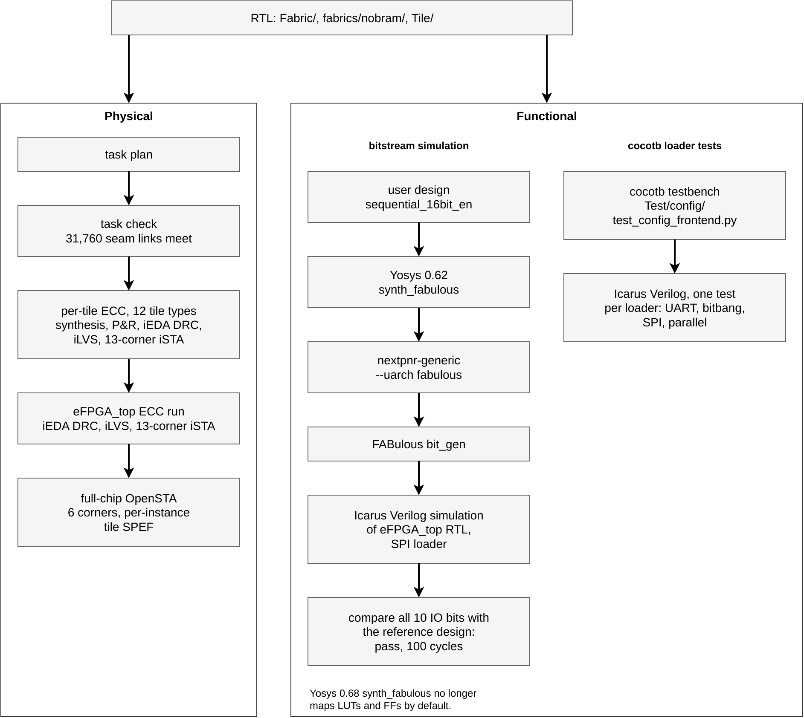

**Figure 5-1. Verification environment.**

### 5.2 Verification Scope and Methods

DRC and LVS are iEDA's checks on LEF abstracts and DEF connectivity. The streamed GDS of Section 7 has no mask-geometry check, because the PDK's decks in `pdk/pv/` are Calibre, unlicensed here, while `pdk/` holds no open deck (KLayout `.lydrc` or `.lylvs`, Magic tech file or netgen setup). Whether the MPW organisers run Calibre DRC and LVS on submitted GDS is unconfirmed. There are no random, formal or FPGA-prototype tests.

### 5.3 Verification Results

| Test category | Test cases | Passed | Failed | Conclusion and open issues |
|---|---:|---:|---:|---|
| Plan wiring (`task check`) | 31,760 links | 31,760 | 0 | Every link meets at one coordinate |
| Per-tile DRC (iEDA) | 12 tile types | 12 | 0 | 0 violations each |
| Per-tile iLVS | 12 tile types | 12 | 0 | 0 opens, 0 shorts |
| `eFPGA_top` DRC (iEDA) | 1 | 1 | 0 | 0 violations |
| `eFPGA_top` iLVS | 3,442 nets, 16,928 instances | 3,442 | 0 | 42 of 42 IO, instances and nets match; 278 power opens (Section 6.3) |
| Full-chip STA (OpenSTA) | 6 corners | 6 | 0 | Section 6.3 |
| Chip-level STA through the pads (OpenSTA) | 1 corner | 1 | 0 | ss 125 °C Cworst only, the one corner extracted so far (Section 6.3) |
| Chip-level STA through the pads (iSTA cross-check) | 1 corner | 1 | 0 | ss 125 °C Cworst, no SPEF. iSTA is more pessimistic at every endpoint, worst setup +0.254 ns against OpenSTA's +4.494 ns, because it ignores Liberty `when` on the pad arcs (Section 6.3) |
| Antenna | 0 | 0 | 0 | Not run; the ECC flow reports no antenna result |
| Bitstream simulation | 1 design, 123 compared cycles | 1 | 0 | No compare error (2026-10-28). `Configured` rises at 433,436.5 µs, then 100 compares follow configuration and 23 a `USER_RESET` pulse. The design uses 12 of 800 `FABULOUS_LC`, 10 `IOBUF` and 2 `GBUF`, with `USER_CLK` on `GBUF` A and `USER_RESET` on `GBUF` B. `A_EN_top[9:2]` rising as the `E_IO` frames load and the counter running on `GBUF` A show rows 1 to 8 and 11 configured. Log in `submission/test/results/bitstream_sim.log`. |
| Gate-level bitstream simulation | 1 design, 123 compared cycles | 1 | 0 | Zero-delay `-Dfunctional` run of the hardened netlists inside `top.v` (`task run-gl-chip`, 2026-10-28, about 4 min), driven and read only at the 22 pads. The SPI load matches RTL timing and defines all 69,746 configuration latches. The gate-level LUT turns an X on an unused input into an X on its output, and that X circulates through unused LUTs and default routing that no reset reaches. The wrapper therefore forces the 788 `FABULOUS_LC` whose loaded configuration is constant to that constant, and a `USER_RESET` pulse clears the power-up X of the flip-flops. The force masks a gate-level fault inside an unused LUT, which no equivalence check covers. On a pad the testbench drives, an enabled output shows only as contention. `task run-gl-top` on the bare macro also passes. Logs in `submission/test/results/gl_chip_sim.log` and `gl_top_sim.log`. |
| cocotb loader tests | 4 loaders | 4 | 0 | 94 s, 2026-10-26 |

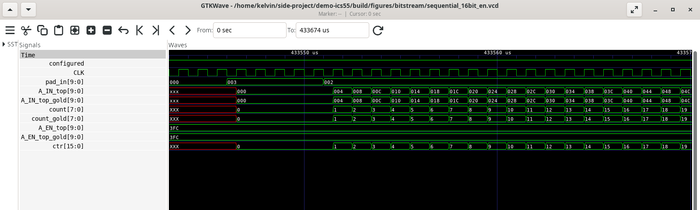

**Figure 5-2. User mode at 433,543 to 433,570 µs. `pad_in` goes 0, 3 (reset), 2 (run), `A_IN_top` counts with `A_IN_top_gold`, `count` and `count_gold` give the counter bits 9:2 of each in decimal and `A_EN_top` equals the gold `3FC`.**

## 6. Synthesis and Physical Implementation Results

### 6.1 Synthesis Results

Tile figures are each tile type's unrounded result times its grid count. Top figures are the configuration logic, synthesised flat with tiles as black boxes. All runs map to `ss_rcworst_1p08_125` liberty through `techmap/ics55_models.v`. `LUT4x8_ha` uses ABC `AREA 5`, while `LUT4x8_ha`, `MACC`, `E_IO` and the configuration logic bar X0P5 to X1 combinational drives from ABC (`WEAK_DRIVES` in `flow/project.py`).

| Item | Result | Tool/Version | Conditions |
|---|---:|---|---|
| Standard-cell count | 179,772 (177,163 in tiles, 2,609 at top) | Yosys 0.68 / ECC `14be467` | As above |
| Combinational cell count | 108,226 (106,307 in tiles, 1,919 at top) | Yosys 0.68 / ECC `14be467` | Total minus flip-flops and latches |
| Sequential cell count | 71,546 (70,856 in tiles, 690 at top) | Yosys 0.68 / ECC `14be467` | Tiles hold 1,110 flip-flops and 69,746 configuration latches, the top 690 flip-flops |
| Macro count | 151 tile macros at top, 0 hard IP | Yosys 0.68 / ECC `14be467` | No hard macro |
| Synthesized area | 682,405 µm² (674,731 in tiles, 7,673 at top) | Yosys 0.68 / ECC `14be467` | Cell area, of which configuration logic is 1.1% |
| Post-synthesis timing | Section 6.3 | ECC STA | Tile constraints time paths through the unconfigured switch matrix, not a user clock |

| Tile | Count | Cells | Area (µm²) | Flip-flops | Latches |
|---|---:|---:|---:|---:|---:|
| `LUT4x8_ha` | 100 | 1,514 | 5,847.5 | 8 | 614 |
| `MACC` | 5 | 2,806 | 10,083.9 | 56 | 830 |
| `E_IO` | 10 | 326 | 1,190.8 | 3 | 120 |
| `W_term` | 10 | 253 | 862.4 | 0 | 96 |
| `N_term` | 10 | 249 | 856.8 | 0 | 96 |
| `S_term` | 10 | 273 | 937.4 | 0 | 104 |
| `N_term_MACC` | 1 | 104 | 116.5 | 0 | 0 |
| `S_term_MACC` | 1 | 126 | 192.4 | 0 | 8 |
| `NW_term` | 1 | 114 | 147.8 | 0 | 4 |
| `NE_term` | 1 | 104 | 116.5 | 0 | 0 |
| `SW_term` | 1 | 157 | 358.4 | 0 | 20 |
| `SE_term` | 1 | 118 | 153.4 | 0 | 4 |
| Configuration logic (`eFPGA_top`) | 1 | 2,609 | 7,673.1 | 690 | 0 |
| Total | | 179,772 | 682,405 | 1,800 | 69,746 |

Without the `IOBUF` BEL each `W_term`, `N_term` and `S_term` has 3 fewer flip-flops and 16 fewer latches than its parent IO tile (Section 2.1). The `USER_CLK` BEL adds no cell to `SW_term`, whose `GBUF` input multiplexers keep their 16:1 trees with one more input in use. The table below splits the configuration logic by each cell's hierarchical prefix after flattening.

| Module | Block | Cells | Area (µm²) | Flip-flops |
|---|---|---:|---:|---:|
| `config_frontend` | `config_UART` loader | 731 | 2,486.4 | 192 |
| `config_frontend` | `config_spi` loader | 241 | 978.0 | 81 |
| `fabric_config` | Frame FSM, header decode, row, frame and column select | 182 | 429.0 | 31 |
| `fabric_config` | `FrameData` register, 384 bits | 1,152 | 3,333.1 | 384 |
| `fabric_config` | `FrameStrobe` decode, 260 bits | 260 | 364.0 | 0 |
| `eFPGA_top` | Cells named after top-level ports (`Configured` 23, `ComActive` 15, `ConfigBusy` 4, `ReceiveLED` 1) | 43 | 82.6 | 2 |
| | Total | 2,609 | 7,673.1 | 690 |

Tying the bitbang and parallel inputs low removes the bitbang loader and the input multiplexer, so no `config_frontend` cell lies outside the two remaining loaders. These take 45% of the configuration logic area (972 cells, 3,464.4 µm²), the UART alone 32%. `fabric_config` takes at least 1,594 cells and 4,126.1 µm², 81% of it the `FrameData` register, plus FSM cells in the port-named row.

After routing the configuration logic is 3,404 cells and 11,372.5 µm². CTS adds 40 buffers (137.8 µm²). The OpenROAD repair adds 755 cells (260 frame-strobe buffers, the `resetn` buffer, 380 slew and capacitance buffers and 114 hold buffers) and resizes the 260 strobe drivers and 140 other cells.

### 6.2 Physical Implementation Results

| Item | Result | Notes |
|---|---:|---|
| Die dimensions | `eFPGA_top` 999.0 × 912.6 µm (911,687 µm²); array 947.0 × 884.8 µm (837,906 µm²) | Array frame from `build/nobram/fabric_plan.json`; the array covers 91.9% of the die |
| Core dimensions | `eFPGA_top` core 904,057 µm²; per tile, die minus 2 µm margin | `LUT4x8_ha` core 6,272.3 µm² |
| Core utilization | `eFPGA_top` 0.42 by ECC's count; tiles in the table below | Netlist cell area over core area, excluding fillers and tap cells |
| Instance count | 238,572 in the routed tiles over the grid; 16,928 at top level | Including physical cells; `LUT4x8_ha` 1,891 (1,524 logic) |
| Macro count | 151 tile macros, 0 hard IP | 100 `LUT4x8_ha`, 5 `MACC`, 10 `E_IO`, 30 edge terminators, 2 `MACC` terminators, 4 corners |
| Peak routing congestion | `LUT4x8_ha` 81 layer-assignment overflows and 0 detailed-routing violations; `eFPGA_top` 40,644 overflows and 2,016 iRT violations | Below the tile table |
| Clock-tree synthesis (CTS) results | Top: 40 buffers, at most 3 levels, 690 flip-flop sinks. Tiles: none | The fabric clock is the `GBUF` network (Section 2.5) |
| I/O pin placement | Meets macro-integration requirements | Tile pins from ECC's file-driven IO placer at `fabric_plan.json` offsets, all held; `eFPGA_top` 42 signal pins (30 user IO, user clock and reset, 10 configuration) and two supply pins |
| Power distribution network (PDN) | Meets requirements | Section 4.3 |

| Tile | Die (µm) | Instances | Core utilisation | Wire (µm) | Vias |
|---|---|---:|---:|---:|---:|
| `LUT4x8_ha` | 82.6 × 84.0 | 1,891 | 0.94 | 59,105 | 12,997 |
| `MACC` | 70.8 × 168.0 | 3,777 | 0.93 | 108,631 | 24,141 |
| `E_IO` | 21.4 × 84.0 | 586 | 0.86 | 11,638 | 2,394 |
| `W_term` | 28.8 × 84.0 | 914 | 0.44 | 9,226 | 1,470 |
| `N_term` | 82.6 × 22.4 | 640 | 0.60 | 8,608 | 1,559 |
| `S_term` | 82.6 × 22.4 | 705 | 0.66 | 9,589 | 1,800 |
| `N_term_MACC` | 70.8 × 22.4 | 494 | 0.10 | 6,329 | 520 |
| `S_term_MACC` | 70.8 × 22.4 | 528 | 0.16 | 7,032 | 745 |
| `NW_term` | 28.8 × 22.4 | 319 | 0.33 | 1,618 | 354 |
| `NE_term` | 21.4 × 22.4 | 282 | 0.37 | 1,247 | 302 |
| `SW_term` | 28.8 × 22.4 | 210 | 0.79 | 2,439 | 694 |
| `SE_term` | 21.4 × 22.4 | 304 | 0.48 | 1,459 | 374 |
| `eFPGA_top` configuration logic | 999.0 × 912.6 | 3,404 | 0.15 | 200,507 | 27,333 |

Values are from the filler step. The top's 0.15 utilisation is 11,372.5 µm² of routed logic over 73,782 µm² of die outside the array. Its 16,928 instances are 3,404 logic cells, 151 tile macros, 4,105 tap cells, 2,680 decap cells and 6,588 fillers.

On `eFPGA_top` iRT's final per-layer table (MET2 412, MET3 672, MET4 672, MET5 260) sums to 2,016. Its final among-net table lists 672, of which 620 are MET3 and MET4 metal shorts and 52 MET3 parallel-run-length spacing, with 0 within-net. iDRC reports 0 on the same DEF (Section 6.3). The origin of the router's count is not yet identified.

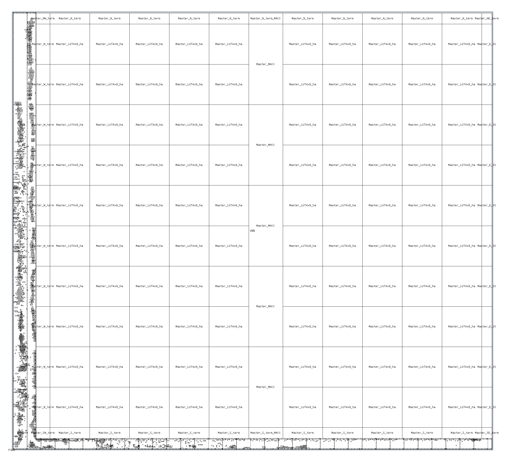

**Figure 6-1. Placed `eFPGA_top` cell outlines (KLayout 0.30.7), with the configuration logic in the west channel and south strip.**

### 6.3 Signoff Results

Per-tile and `eFPGA_top` signoff come from ECC `14be467`, full-chip OpenSTA from `build/nobram/fullsta/`, chip-level OpenSTA from `build/nobram/chip/sta_ss_125_Cworst.log`, the chip-level iSTA cross-check from `build/ista-2026-10-28/chip/` and per-tile OpenSTA from `build/sta-recheck-2026-10-21/`. Per-tile OpenSTA covers the 11 tile types other than `SW_term`, which full-chip OpenSTA covers.

| Check | Status | Violation count | Disposition |
|---|---|---:|---|
| Setup timing, tiles (iSTA) | Fail, waived | Worst corner 81 endpoints on `LUT4x8_ha` (WNS −14.924 ns) and 188 on `MACC` (WNS −65.706 ns), 0 on the other 10 types | Loops through the unconfigured switch matrix (tile timing below) |
| Hold timing, tiles (iSTA) | Fail, waived | Every type, worst-corner WNS −0.456 to −0.500 ns; 265 endpoints on `LUT4x8_ha` and 441 on `MACC` | 0.5 ns uncertainty on an ideal clock (tile timing below) |
| Setup and hold, `eFPGA_top` alone (iSTA) | Pass | 0 | Setup +6.200 ns at ss 125 °C Cworst, hold +0.071 ns at ff −40 °C Cbest |
| Full-chip setup and hold (OpenSTA) | Pass | 0 | Six corners, the figure of record (table below) |
| Chip-level setup and hold through the pads (OpenSTA) | Pass at ss 125 °C Cworst | 0 | Worst setup +4.494 ns to `PAD_CFG_LED`, worst hold +4.849 ns (chip-level STA below) |
| Chip-level setup and hold through the pads (iSTA cross-check) | Pass at ss 125 °C Cworst | 0 | Worst setup +0.254 ns, worst hold +4.602 ns, more pessimistic than OpenSTA at every endpoint (iSTA cross-check below) |
| Minimum pulse width (OpenSTA) | Pass | 0 | Six corners, full chip and the 11 tile types other than `SW_term` |
| Slew and capacitance (OpenSTA) | Pass | 0 | Six corners, full chip and the 11 tile types other than `SW_term` under their own SDC and SPEF. iSTA's tile report writes both as a constant 0 (`TimingReporter.cpp`). |
| DRC | Pass | 0 per tile; 0 on `eFPGA_top` | iEDA DRC on abstracts. iRT's 620 shorts on `eFPGA_top` are unresolved (Section 6.2). |
| LVS | Pass on signal, power opens on top | 0 per tile; 278 on `eFPGA_top` | iLVS of routed DEF connectivity against the netlist, excluding the 31,760 tile-to-tile nets and the 644 unconnected edge outputs. On `eFPGA_top` all 3,442 nets connect with 0 shorts. The 278 opens are 139 VDD and 139 VSS tile supply pins fed by abutment, which iLVS does not see. |
| Antenna checks | Not run | N/A | The ECC flow reports no antenna result |
| Other checks | Pass, plan level | 0 | `task check`: 31,760 of 31,760 seam links meet |

**Tile timing.** The failing tile setup paths are combinational loops of up to 122 stages (`MACC`) through the unconfigured switch matrix and transparent configuration latches, which no configured design forms. OpenSTA breaks the loops differently and reports −14.337 and −67.463 ns at ss 125 °C Cworst. ECC's totals of 387 and 2,331 violations sum the 13 corners. The hold failures come from the ECC SDC, which puts 0.5 ns uncertainty (5% of 10 ns) on an ideal clock, so every feedthrough under 0.5 ns and every flip-flop self-loop fails. The worst `LUT4x8_ha` hold path in OpenSTA is a 0.6 ps wire at −0.499 ns. Under the full chip's 50 ps uncertainty the tile registers pass. The `eFPGA_top` iSTA run reads the ss-only tile Liberty, which has no hold arc, with no hold uncertainty. It agrees with full-chip OpenSTA on setup within 29 ps, both worst paths starting at `ComActive_reg_p`.

**Full-chip OpenSTA.** `flow/sta/run.sh` times both clocks at 10 ns with 50 ps hold uncertainty (`HOLD_UNC`). The user clock `uclk` starts at the `USER_CLK` port, with case analysis selecting it on all four `GBUF` input multiplexers and the `GBUF` and `MACC` clock-inversion bits at 0. Its setup depends on the configured design and is not timed. `USER_RESET` is timed as data launched by `uclk` at its port and captured through the `GSR` multiplexer of every `LUT4x8_ha`, the path a reset taken through `GBUF` B follows.

| Corner (liberty, SPEF) | `CLK` setup | `CLK` hold | User-clock hold, `LUT4x8_ha` | User-clock hold, IO | User-clock hold, `MACC` | `USER_RESET` setup | `USER_RESET` hold |
|---|---:|---:|---:|---:|---:|---:|---:|
| ff 1.32 V −40 °C, RCbest | +8.722 | +0.043 | +0.046 | +0.418 | +0.043 | +9.491 | +0.032 |
| ff 1.32 V −40 °C, Cbest | +8.758 | +0.040 | +0.044 | +0.397 | +0.042 | +9.511 | +0.034 |
| ff 1.32 V 125 °C, Cbest | +8.605 | +0.050 | +0.058 | +0.465 | +0.052 | +9.433 | +0.044 |
| ff 1.08 V 125 °C, RCbest | +8.028 | +0.091 | +0.102 | +0.669 | +0.097 | +9.154 | +0.076 |
| ss 1.08 V 125 °C, Cworst | +6.229 | +0.200 | +0.229 | +1.375 | +0.220 | +8.254 | +0.202 |
| ss 1.08 V −40 °C, Cworst | +6.316 | +0.191 | +0.215 | +1.335 | +0.204 | +8.234 | +0.159 |

All 1,110 user-clock flip-flops (800 in the logic cells, 280 in `MACC`, 30 in `E_IO`) meet hold. IO hold slack is largest because every IO flip-flop sits in column 12, at the far end of the `E_GBUF` spine from `SW_term`. The worst `CLK` setup path at ss 125 °C Cworst runs from `ComActive_reg_p` to `Configured_reg_p` and arrives at 4.134 ns.

**Chip-level STA.** OpenSTA times `top.v` and `top.sdc` against the IO ss Liberty and `eFPGA_top_ss_125_Cworst.lib`, which `flow/sta/etm.tcl` extracts with `write_timing_model` after cutting the 32 user-side ports. The worst setup path, to `PAD_CFG_LED`, arrives at 5.506 ns. `resetn` setup is +8.798 ns. The input pad adds 1.865 ns, the output pad 2.310 ns into 10 pF and the `PAD_CLK` pad 1.875 ns. The SDC false-paths hold from the five configuration inputs, which `CLK` samples through synchronisers. Timed, they fail hold by about 1.5 ns, because the clock pad and macro clock tree outrun one data pad. The 10 `PAD_IO` bits carry user timing and stay unconstrained. The other five corners are not extracted.

**iSTA cross-check.** iSTA through `ecc_py` (ECC `14be467`) reads the same inputs with no SPEF (`run_ista_chip.py`) and gives setup into `eFPGA_top` of +8.177 to +9.850 ns against OpenSTA's +8.798 to +10.471 ns. Three iSTA defects each need a workaround on an iSTA-only copy of the inputs. iSTA compares the Liberty `capacitive_load_unit` case-sensitively with `pf` (`LibParserCpp.cc:721`), so it reads the `pF` that `write_timing_model` writes as fF and the run uses a copy of the model with `pf`. iSTA cannot build the timing graph through an inout port (`GraphBuilder.cpp:244`), so the run uses a Yosys copy of `top.v` without the 10 `PAD_IO` pads, which `top.sdc` false-paths. iSTA never reads the Liberty `when` condition, so the `DS0`, `DS1` and `CS` tie-offs leave every conditional `P65_1233_PBMUX` arc enabled and iSTA times the slowest. On `PAD_CFG_LED` that arc takes 6.773 ns through `u_pad_4`, where OpenSTA keeps a 2.354 ns arc and `report_edges` shows the others disabled by constant. The 4.419 ns difference is the 4.240 ns setup gap plus the 0.18 ns by which iSTA's clock latency and `eFPGA_top` output arc are smaller, so OpenSTA's figure is the correct one. iSTA's `PAD_CLK` latency of 1.783 ns against OpenSTA's 1.875 ns is unexplained. Full-chip STA is OpenSTA only, because iSTA reads one SPEF file and the per-tile SPEFs are not stitched into the top-level seam nets.

**Drive strength.** ECC sizes no cell after ABC, so drive buffers in `techmap/ics55_models.v` and OpenROAD repair between legalisation and routing (`flow/repair_tile.tcl`, `flow/repair_top.tcl`) set the drive strengths that close slew, capacitance and hold.

| Block | Fix |
|---|---|
| `LUT4x8_ha` | `BUFX8H7L` per `FABULOUS_LC` output, which drives about 40 switch-matrix loads (0.09 to 0.10 pF), then `repair_design` |
| `MACC` | `BUFX8H7L` per Q bit, `BUFX4H7L` enable and reset copies and `BUFX5H7L` strobes, then driver upsizing against 1.5 times the estimated wire capacitance |
| `S_term` | `BUFX5H7L` per frame strobe |
| `E_IO`, `S_term_MACC`, `SW_term` | Techmap drive buffers |
| Configuration logic | X0P5 to X1 drives barred in synthesis, `NOR2BX6H7L` strobe drivers with a `BUFX12H7L` per tile pin because iRT detours those nets by 100 to 1,000 µm against a 3 µm placement estimate, a `resetn` buffer for 296 loads, then `repair_design` and `repair_timing -hold` (cell counts in Section 6.1) |

## 7. Layout

The layout of record is `build/nobram/top/default/filler_ecc/output/eFPGA_top_filler.def.gz`, the only view carrying all 35,846 nets (3,442 routed, 31,760 tile-to-tile and 644 unconnected `FrameData_O` and `FrameStrobe_O` edge outputs restored unrouted).

ECC's GDS is not mask data. It writes standard cells and tile macros as flat LEF abstracts, so in the top GDS `Master_N_term_MACC` is 549 shapes with no sub-cells. It numbers layers by their order in the tech LEF `pdk/prtech/techLEF/N551P6M.lef` (MET1 7/0, MET5 15/0), not by `pdk/techfile/icsprout55.layermap` (MET1 81/1).

Mask-layer GDS exists for `SE_term` only (Figure 7-3), from the KLayout script `build/gds-stream-2026-10-22/def2gds.py`. It maps the routed DEF through `icsprout55.layermap` and takes every cell from the PDK `ics55_LLSC_H7C{R,L}_M2.gds`, whose MET2 pins match the `_ecos` LEFs ECC routed against. On `SE_term` it resolves 304 of 304 placed cells to PDK layout, labels 116 of 116 pins and matches the DEF die. The script fails on any unmapped layer or empty cell. The other 11 tile types and `eFPGA_top` are not yet streamed out.

The GDS lacks a cell boundary, because the layermap has no entry for the LEF `OVERLAP` layer or the DEF outline and the foundry's boundary layer is unknown. The OpenECOS team places the 26 pads from `top.v` with the PDK's `ICSIOA_N55_3P3_1P6M1TM.gds`. The PDK ships no seal ring.

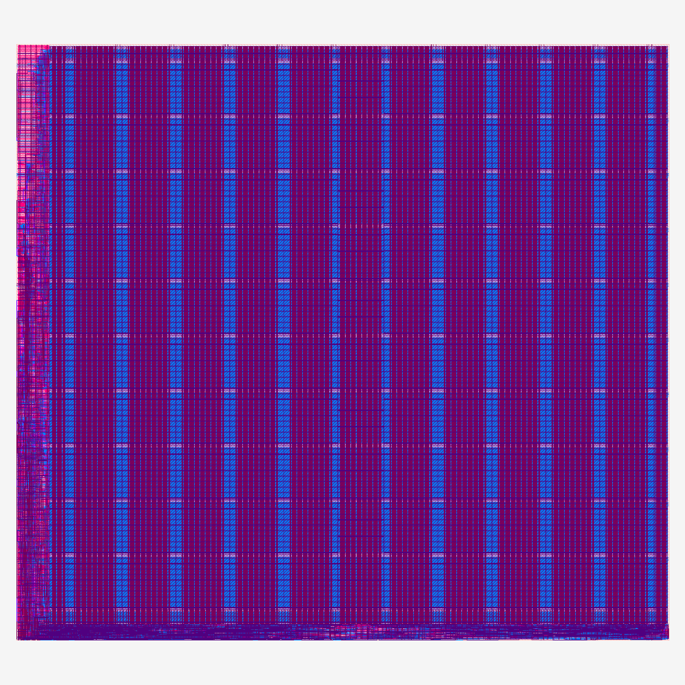

**Figure 7-1. Routed `eFPGA_top`, ECC render after filler insertion, with tiles drawn as LEF abstracts.**

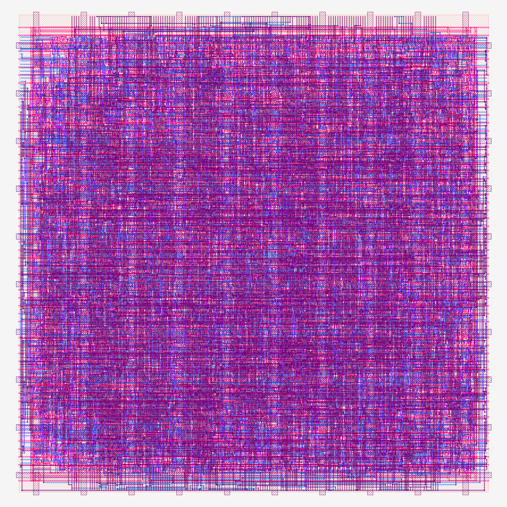

**Figure 7-2. Routed `LUT4x8_ha` tile, 82.6 × 84.0 µm, ECC render at the STA step.**

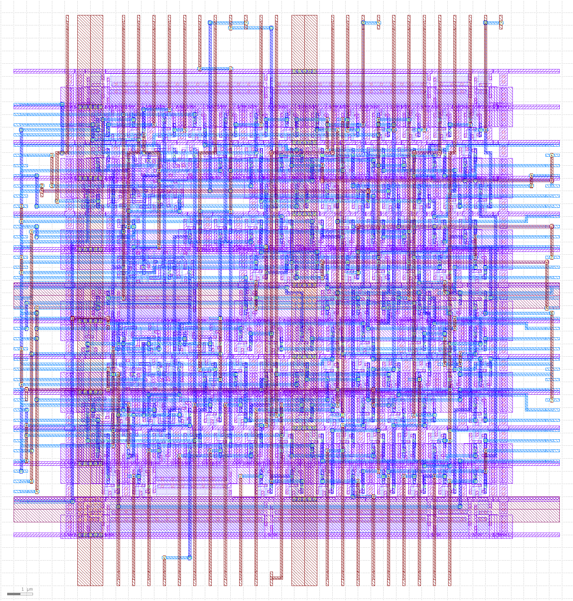

**Figure 7-3. `SE_term`, 21.4 × 22.4 µm, KLayout render of `build/gds-stream-2026-10-22/SE_term.gds` with PDK standard-cell layout on ICS55 layer numbers.**

## 8. Post-Silicon Test Plan

### 8.1 Test Setup

In the planned setup, pending MPW package and board information, a host builds bitstreams (Section 2.6) and a Pico loads them over SPI. The Pico also reads `ConfigBusy` and `Configured`, supplies the user clock, drives `USER_RESET`, holds `resetn` and samples the IO bits.

[Power supplies, clock source for `CLK`, probes and board connections, pending the MPW board.]

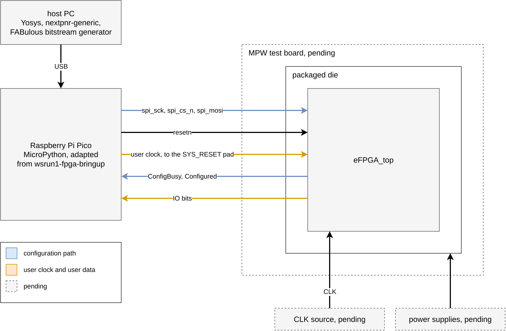

**Figure 8-1. Planned post-silicon test setup.**

### 8.2 Test Procedures and Expected Results

| Test item | Procedure | Expected result | Passing criteria |
|---|---|---|---|
| Power-up and reset | Apply supply, hold `resetn` low, release | `ConfigBusy` and `Configured` low; IO pads may drive, since `A_EN_top` follows unreset latches (Section 2.5) | [Criteria] |
| Basic functionality | Load a counter bitstream over SPI, clock it through the `USER_CLK` pad, pulse `USER_RESET` | `ConfigBusy` high during the load, `Configured` high after it; counter value on the IO bits, cleared by the pulse | Output matches the simulated design cycle for cycle |
| Boundary conditions | Load a design that uses all 5 `MACC` and the carry chain across a full column | Products and sums match the reference model | [Criteria] |
| Partial reconfiguration | Load a counter, then rewrite the frames of one column while the counter runs elsewhere | The untouched region keeps counting; the rewritten region takes its new function | [Criteria] |
| Frequency/voltage sweep | Raise the user clock until the counter fails, at several supplies | Pending: no Fmax prediction exists | [Criteria] |

## 9. Open-Source Contribution

### 9.1 Motivation for Participating in the Open-Source Tapeout Program

[Describe your motivation, the design idea you intend to validate, and why you chose the open-source community tapeout program.]

### 9.2 Artifacts to Be Released

| Artifact | Will it be released? | Planned release date | Notes |
|---|---|---|---|
| RTL/netlist | Yes | [YYYY-MM-DD] | FABulous RTL, configuration logic, per-tile and `eFPGA_top` netlists |
| Verification environment and test vectors | Yes | [YYYY-MM-DD] | `flow` checks, full-chip STA scripts, bitstream testbench, gate-level wrapper generator, cocotb loader tests |
| Software, drivers, or reference models | Yes | [YYYY-MM-DD] | FABulous toolchain is upstream |
| Physical data such as LEF/DEF/GDSII/OASIS | Yes | [YYYY-MM-DD] | Tile LEF, Liberty, DEF and SPEF, `eFPGA_top` DEF and SPEF; mask-layer GDS once every tile and the top are streamed out |
| Tool scripts and configuration | Yes | [YYYY-MM-DD] | `flow/`, `Taskfile.yml`, `ecc_config.toml` files |
| Post-silicon measurement data | Yes | After bring-up | Published as it is taken; none exists before silicon returns |
| Documentation and tutorials | Yes | [YYYY-MM-DD] | `README.md`, `SPEC.md` |

### 9.3 Value to the Open-Source Community

To the best of the authors' knowledge, this project is the first fully open FPGA taped out on the open ICS55 55 nm process. FABulous generates the fabric from the open fabulous-tiles library. ECC synthesises, places, routes and signs off every tile and the top level on the open ECOS PDK. The 12 hardened tile types have frozen dies, fixed pin orders and a PDN that joins by abutment. A later project takes `eFPGA_top` as one block or re-abuts the same tiles into a fabric sized for its own die without hardening anything again (Sections 4.3, 4.5 and 4.7). On this chip a bitstream rather than the masks fixes an MPW user's logic, so logic on the 800 logic cells, 5 `MACC_8x8_20` blocks and 10 IO bits is corrected or replaced after fabrication. A partial bitstream rewrites only the changed frames while the rest of the fabric runs (Section 2.2). A research group can use the fabric as delivered for an experimental accelerator, an instrument or sensor interface or a teaching platform. It can also generate a fabric for its own application from the same open flow, which opens 55 nm chip design to universities, research teams and individual developers.

#### 9.3（中文版）开源社区价值

据我们所知，本项目是首个在开放的 ICS55 55 纳米工艺上流片的全开源 FPGA。FPGA 架构由 FABulous 基于开源的 fabulous-tiles 库生成，每一种 tile 以及顶层均在开源的 ECOS PDK 上由 ECC 完成综合、布局、布线与签核。12 种已完成物理实现的 tile 具有固定的尺寸和引脚顺序，其供电网络通过拼接（abutment）直接连通。后续项目可以将 `eFPGA_top` 作为一个整体模块集成，也可以将同一套 tile 重新拼接为适合自身芯片面积的 FPGA，无需重新进行物理实现（见第 4.3、4.5 和 4.7 节）。在本芯片上，MPW 用户的逻辑由比特流而非掩模决定，映射到 800 个逻辑单元、5 个 `MACC_8x8_20` 模块和 10 个 IO 位上的逻辑在制造完成后仍可修正或替换。部分比特流仅重写需要修改的帧，其余逻辑持续运行（见第 2.2 节）。研究团队可以直接使用本 FPGA 开发实验性加速器、仪器或传感器接口以及教学平台，也可以基于同一套开源流程生成面向自身应用的 FPGA，从而让更多高校、科研团队和个人开发者能够参与 55 纳米芯片设计。

### 9.4 Suggestions for the Platform and Flow

1. A hook for a user techmap before ECC's `flatten` (ecc#302), so FABulous `my_buf` buffers survive as cells.
2. A tagged ECC release with the file-driven IO placer (`io_placer.mode = "file"`), which is on `main` only and not on `v0.1.0-alpha.12`.
3. Harden outputs with the routed layout and port timing, in place of the LEF-abstract GDS and 2-arc timing model ECC writes for `eFPGA_top`.
4. A way to mark abutment-connected nets in iRT. On a 122-tile fabric 27,390 such nets grew the shape database to 49 GB before routing.
5. A flag to stream full standard-cell layouts into iEDA's GDS, which now holds LEF abstracts.
6. Escaping of `$` in iRCX SPEF and netlist names, which OpenSTA rejects.
7. iSTA support for the Liberty `when` condition, a case-insensitive `capacitive_load_unit`, inout ports and a multi-file or hierarchical SPEF, without which iSTA cannot time the pad ring or the full chip (Section 6.3).
8. Public MPW die-size, pad-ring and seal-ring rules, with a seal ring in the PDK.

## 10. Lessons Learned and Future Work (Optional)

### 10.1 Lessons from Design and Verification

`task check` and the stale-die guard in `harden` reject a broken or stale plan in seconds, before any harden starts.

Dense tiles route only with DreamPlace detailed placement and area-driven synthesis. Without detailed placement `LUT4x8_ha` at 0.93 core utilisation oscillates between 2,134 and 2,643 violations over nine detailed-routing iterations. With it the count reaches 0. ABC `AREA 5` in place of the default `DELAY 4` saves the cell area the 82.6 µm die needs.

Per-tile STA sees each tile's `GBUF` feedthrough as a wire, so a global clock crossing abutted tiles needs full-chip STA with per-instance tile SPEF. Unbuffered, each global clock would be one net of fanout 345 driven by one XOR, hence one buffer per tile hop. ECC sizes cells only in synthesis, so drive strength needs post-placement repair (Section 6.3).

### 10.2 Physical Implementation Issues

1. **LUT column width.** `LUT4x8_ha` routes at 82.6 µm but not at 81.8 µm, where placement reaches 0.9888 of the placeable area and three DRC violations remain after nine detailed-routing iterations.
2. **Boundary buffers.** ECC synthesis flattens every FABulous `my_buf` into a net alias. A techmap onto `BUFX1H7L`, with a mux map onto `MUX4X1H7L` and `MUX2X1H7L`, keeps the 288 buffers per tile for about 1% of cell area through an uncommitted ECC edit.
3. **Top-level routing.** The tile-to-tile nets connect by geometry only in the DEF. A planned alternative separates the tiles by a 1.4 µm gap with one straight pre-routed wire per seam net and bridged power stripes. On the upper half of the double-height `MACC` this needs a re-harden at 168 µm plus the gap or iRT jogs on those nets.
4. **Global placement on the top.** Legalise-only placement piles every standard cell into one corner. Global placement converges only with `place.target_overflow = 0.15`.

### 10.3 Planned Improvements

The next revision targets a mask-ready GDS with the pad ring and seal ring, a partial-reconfiguration simulation, `ComRate` matched to the 100 MHz `CLK` and a routed user design timed across the tiles' extracted Liberty, all on an ECC build with no uncommitted edits.

## 11. Additional Information

### 11.1 Known Limitations

- User-mode Fmax is unmeasured. The tile-level `sta_frequency_mhz` 40 on `LUT4x8_ha` reflects a loop through the unconfigured switch matrix.
- RTL simulation shows `GBUF` A carrying the user clock and `GBUF` B the user reset into `GSR`. A counter clocked through `GBUF` C stays X although nextpnr routes the clock to every flip-flop, for a reason not yet found. `GBUF` B as a clock and `GBUF` D are untested.
- `A_EN_top` is not gated by `Configured`. The configuration latches have no reset, so before and during configuration any of the 10 IO pads may drive (Section 2.5).
- Gate-level simulation passes only with the 788 constant logic cells forced, which masks a fault inside an unused LUT. No equivalence check of the tile netlists against RTL exists (Section 5.3). No partial-reconfiguration run exists.
- `ComRate` = 217 is mismatched to the 100 MHz `CLK` (Section 2.5).
- Mask-layer GDS for `SE_term` only, with no cell boundary layer, pad ring or seal ring. The PDK's Calibre decks have not been run and no open deck exists (Sections 5.2 and 7).
- 10 user IO bits in total, all in column 12.
- Row 0 configuration is shown only by routed nets, not in simulation.
- ECC's `eFPGA_top` Liberty holds 2 zero-delay arcs for 42 pins. The extracted model times the configuration ports at ss 125 °C Cworst only. It gives the 32 user-side ports no arcs.
- The chip-level SDC's board conditions, a 10 pF load, a 1 ns input transition and zero external delay, are assumptions pending the MPW board.
- 278 power opens in `eFPGA_top` iLVS (Section 6.3).
- iRT ends the `eFPGA_top` route with 620 MET3 and MET4 metal shorts and 52 spacing violations in its among-net table, while iDRC reports 0 on the same DEF. No independent check has resolved which is right (Section 6.2).
- No block RAM or multi-port storage. `FABULOUS_LC` has no LUT RAM because only the configuration chain writes its truth table.
- A plain `git archive` of the branch ships three primitives the design does not instantiate (`ICS55_SRAM_512x32_1RW` with its vendor Liberty, `IHP_SRAM_1024x32_1RW`, `RAM_32x4_2R_1W`), so they must be stripped before release.
- Device programming and the post-silicon setup are plans (Sections 2.6 and 8.1).

### 11.2 Open-Source Projects, Third-Party IP, and Licenses

| Name | Purpose | Source/Repository | Version | License | Modified? |
|---|---|---|---|---|---|
| FABulous | Fabric generator, RTL and pin-order generation | `github.com/FPGA-Research/FABulous` | `c0ca476` (`user-clk-attr`), `092f606` (`fix-direction`) | Apache-2.0 | [Yes/No] |
| fabulous-tiles, classic library | Tile definitions and switch matrices | `github.com/FPGA-Research/fabulous-tiles` | `5809cdf` | [License] | Trimmed to the tiles used; `ecc_config.toml` added per tile |
| fabulous-fabrics `fabric_config` | Frame-based configuration FSM | [URL] | `7223ee9` | Apache-2.0 (SPDX header in `Fabric/fabric_config.sv`) | Vendored; front-ends added beside it |
| ECC (ECOS Chip Compiler) | Synthesis to routed macro per tile and for `eFPGA_top` | [URL] | `main` `14be467` | Apache-2.0 | Yes: two uncommitted edits (Section 4.6) |
| Yosys | Synthesis, inside ECC | `github.com/YosysHQ/yosys` | 0.68 `38e001a` | ISC | No |
| iEDA, DreamPlace | Placement, routing, DRC, iLVS, STA, inside ECC | [URL] | as bundled with ECC `14be467` | [License] | No |
| OpenSTA | Full-chip and chip-level STA, timing-model extraction | `github.com/parallaxsw/OpenSTA` | 2.7.0 | GPL-3.0 | No |
| OpenROAD | Slew, capacitance and hold repair between legalisation and routing (Section 6.3) | `github.com/The-OpenROAD-Project/OpenROAD` | `dcf3613` | BSD-3-Clause | No |
| wsrun1-fpga-bringup | Planned bring-up flow and Pico loader | `github.com/mole99/wsrun1-fpga-bringup` | `81a9a99` | Apache-2.0 | Yes, planned (Section 2.6) |
| ICS55 ECOS PDK | Technology, standard cells and IO cells | `github.com/openecos-projects/icsprout55-pdk` | `v1.10.103` (`2d72857`) | Apache-2.0 (repository licence; cell-library terms to be confirmed) | No |
| ICS55 IO library `ICsprout_55LLULP1233_IO_251013` | `P65_1233_PBMUX` pads in the chip-level netlist | ICS55 ECOS PDK | as the PDK | as the PDK | No |
| This project | Flow, configuration, frozen dies, chip-level netlist | `github.com/KelvinChung2000/demo-ics55` | `20f8422`, chip level `c680d08` | [No licence file yet] | N/A |

### 11.3 Attachments and Deliverables

`submission/collect.py` rebuilds the self-contained appendix `submission/` from the working tree and `build/nobram/`, taking the RTL as the Yosys module closure of `eFPGA_top`. Table paths are relative to `submission/` and other paths to the repository root.

| File/Directory | Revision or commit | Purpose | Submitted? |
|---|---|---|---|
| `ECOS_Community_Tapeout_Project_Design_Report.md`, `images/` | this report | Report, figures and `.drawio` sources; the GTKWave and KLayout capture scripts for Figures 2-3, 2-4, 5-2 and 6-1 are in `capture/` | Yes |
| `rtl/` with `rtl/filelist.f` | `20f8422` | The 52 source files of `eFPGA_top` in Icarus compile order | Yes |
| `rtl/config/` | `20f8422` | `fabric.csv`, `dies.toml`, per-tile `io_pin_order.yaml` and `ecc_config.toml` | Yes |
| `fabric/` | `20f8422` | FABulous project of the fabric with the 12 tile types, `Tile/common`, `Tile/include` and the six instantiated primitives, symlinks resolved | Yes |
| `physical/eFPGA_top/` | built from `20f8422` | Filler DEF, netlist, ECC GDS, SPEF at nine RC corners, Harden LEF, Liberty and GDS | Yes |
| `physical/tiles/<type>/` | `SW_term` built from `20f8422`, the other 11 types from `f82fb9a` | Filler DEF, netlist, ECC GDS, SPEF at nine RC corners, abstract LEF, extracted Liberty | Yes |
| `physical/fabric_plan.json` | built from `20f8422` | Dies, pin offsets, seams | Yes |
| `signoff/<block>/` | as `physical/` | ECC DRC count and per-layer table, iLVS report and the iSTA reports of every corner | Yes |
| `sta/` | built from `20f8422` | Full-chip OpenSTA scripts, logs, reports and `summary.txt` | Yes |
| `gl/` | built from `20f8422` | `top_full.v` with all seam nets and the 12 tile netlists, the inputs of the gate-level simulation of Section 5.3 | Yes |
| `chip/` | `c680d08` | `top.v` and `top.sdc` from `flow cli chip-top`, the extracted `eFPGA_top` model `etm/eFPGA_top_ss_125_Cworst.lib` and the chip-level STA log of Section 6.3 | Yes |
| `test/` | design `20f8422`, testbench `3a0507a`, harness this report | `Taskfile.yml` running the RTL and gate-level simulations of Section 5.3 and the bitstream build on the files of this appendix only; the counter design, testbench and PCF in `user_design/`; the submitted bitstream in `bitstream/`; the Section 5.3 logs in `results/`; the nextpnr model and bitstream specification in `fabulous_model/`; the FABulous primitives and technology maps for Yosys 0.67 and newer in `yosys/`; the gate-level wrapper generator `gen_gl_top.py` and the cocotb loader tests in `config/` | Yes |

Every appendix GDS is an ECC abstract (Section 7). The build flow and documentation stay in the repository.

## Pre-Submission Checklist

- [ ] Project name, project lead, contributors, repository URL, source revision (commit/tag), and process/PDK version are provided.
- [ ] Targets and measured results are clearly distinguished, with units, tool versions, and test conditions included.
- [ ] Top-level interfaces, clocks, resets, I/O, PDN, and physical boundaries are documented.
- [ ] If IP reuse is planned, the supported reuse levels, baseline specification, deliverables, and acceptance criteria are complete.
- [ ] If reuse is not currently supported, the reasons and future plans are documented.
- [ ] Simulation, synthesis, place-and-route, DRC/LVS, and other signoff results match the final submitted revision.
- [ ] Figures, source code, scripts, netlists, physical views, and licenses are archived according to the deliverables list.
- [ ] Known issues, waivers, and post-silicon test considerations are documented.
