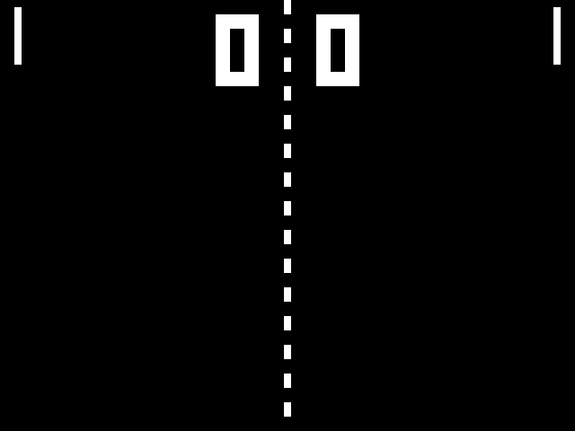

# paddle_ball, a demonstration design for the fabric

paddle_ball is a two-player paddle-and-ball game with two balls in play, drawn on 640 × 480 VGA. It runs at 6.29375 MHz, a quarter of the 25.175 MHz dot clock, so the playfield is 160 × 120 logical pixels of 4 × 4 screen pixels. Each paddle follows an AI that chases the nearest incoming ball within 64 pixels of its own wall, and a button pair takes a paddle over. A score past 9 restarts the match. The design is written to occupy the whole fabric, and places 651 of 800 `FABULOUS_LC`, all 10 `IOBUF`, all 5 `MACC_8x8_20` and 2 of 4 `GBUF`.

The five MACCs each do arithmetic the game needs. Two chained MACCs per ball test whether the pixel under the beam lies inside that ball's disc, `m(dx)² + m(dy)² ≤ r(r+1)` with `r = 3`, the first computing `m(dx)²` and the second adding `m(dy)²` through its C input. The fifth steps the serve generator `x' = 141x + 1 mod 256`, whose period is the full 256. Every MACC register is bypassed. The `CLK` pin still takes the user clock, because the MACC tile routes `CLK` only from the global clock lines.

## Pads

`paddle_ball_pcf.v` makes the pads its top-level ports, and `paddle_ball.pcf` places each one. Pad `i` is the `IOBUF` behind `A_IN_top[i]`, `A_EN_top[i]` and `A_OUT_top[i]` of `eFPGA_top`.

| Pad | Port | Direction | Function |
|---:|---|---|---|
| 0 | `hsync_n` | out | VGA horizontal sync, active low, 24 clocks in a 200-clock line |
| 1 | `vsync_n` | out | VGA vertical sync, active low, 2 lines in a 525-line frame |
| 2 | `red` | out | VGA red, one bit |
| 3 | `green` | out | VGA green, one bit |
| 4 | `blue` | out | VGA blue, one bit |
| 5 | `p1_up` | in | Left paddle up |
| 6 | `p1_down` | in | Left paddle down |
| 7 | `p2_up` | in | Right paddle up |
| 8 | `p2_down` | in | Right paddle down |
| 9 | `sound` | out | 983 Hz square wave for 6 frames after a paddle hit, wall hit or point |

The clock enters on the `USER_CLK` pad through `GBUF` A and the reset on the `USER_RESET` pad through `GBUF` B, as `test/harness/pcf_top.v` does. The reset `GBUF` reaches only a flip-flop's set/reset pin, so `user_reset` clears a 2-bit wake counter and the game resets from that counter's output.

## Running it

Every task runs from this directory with [Task](https://taskfile.dev). `build` calls the bitstream tasks of `../../test/Taskfile.yml`, so it uses the same Yosys, nextpnr and `bit_gen` set-up and the FABulous model in `../../test/model/fabulous/`.

| Task | What it does | Time |
|---|---|---|
| `task run-rtl-verilator` | Simulates the design alone for `FRAMES` frames (600) and writes every `STRIDE`-th frame (8) as a PPM, a GIF at game speed and a 4 × 3 contact sheet into `build/verilator/` | 12 s plus the Verilator build |
| `task run-rtl` | The same on Icarus Verilog, into `build/rtl/` | about 11 min |
| `task live` | Streams every frame of the Verilator simulation into an `ffplay` window for `LIVE_FRAMES` frames (36,000, 10 min of play). View only: the testbench presses the buttons | 24 ms per frame, about 70% of real time |
| `task build` | Synthesises `paddle_ball_pcf` with `iobuf_map.v`, places it with `paddle_ball.pcf` at 6.29375 MHz and writes `build/fabric/paddle_ball.hex` | 9 s |
| `task run-fabric` | Loads `BITSTREAM` (`bitstream/paddle_ball.hex`) into the `eFPGA_top` RTL over SPI, then compares all ten pads with the design simulated directly, every cycle, for `FABRIC_FRAMES` frames (2) | 58 min for 2 frames, then about 8 min per frame |

`run-rtl`, `run-rtl-verilator` and `live` fail unless the run scores at least one point, makes at least four paddle hits and plays both balls, so they need at least about 200 frames. `run-fabric` fails on the first pad that differs from the design simulated directly. `build` needs the FABulous `bit_gen` on `PATH` and takes `YOSYS_PATH` and `NEXTPNR_PATH` like the test harness. Yosys 0.62 rebuilds `bitstream/paddle_ball.hex` byte for byte.

## How the testbenches see the game

`vga_monitor.v` reads only the five video pins. It checks a 200-clock line with a 24-clock sync, a 525-line frame with a 2-line sync, and no X on any pin, and stops the run with `$fatal` otherwise. It rebuilds each frame from the sync timing and writes it as a 160 × 480 PPM. `+stream=<path>` appends every frame to one file or FIFO, which is how `live` feeds `ffplay`. The same monitor serves the RTL and the fabric testbench, so the two produce frames from the same pins in the same way.

`paddle_ball_rtl_tb.v` holds the left paddle's up button over frames 100 to 130 and counts points, paddle and wall hits from the design's internal signals. `paddle_ball_fabric_tb.v` runs the fabric and the design side by side on one clock, reset and button sequence. The fabric's `MACC_8x8_20` and the behavioural model in `macc_model.v` share a name, so `run-fabric` renames the model in the reference copy.

## Results

`results/rtl_sim.log` is the 600-frame Verilator run: 4 points to the left player and 1 to the right, 13 paddle hits, 10 wall hits and both balls in play together for 325 frames. `results/contact_sheet.png` shows 12 of its frames, the score rising from 0:0 to 4:1. In this run the first wall hit falls in frames 66 to 70, the first paddle hit in frames 76 to 80 and the first point in frames 111 to 115.

`results/fabric_sim.log` is `run-fabric` on `bitstream/paddle_ball.hex`: the SPI load sets `Configured` at cycle 433,436, then 308,404 of 308,404 compares match on all ten pads over 2 frames. The monitor's frames 0 and 1 from the fabric's video pads are byte-identical to the RTL frames 0 and 1. They show the playfield, the score and both paddles but no ball, since the first ball blinks on at frame 8. A 120-frame run of the same bitstream, still running on 2026-11-02, matched all 1,043,404 compares up to the start of frame 9, and its frame 8, with ball A drawn by the MACC disc test, is byte-identical to the RTL frame 8. That run reaches the first wall hit, paddle hit, button press and point in frames 66 to 130.

## Limits

- Timing comes from full-chip OpenSTA of this bitstream, 16.7 MHz reg-to-reg and 14.3 MHz through the colour pads at ss 125 °C Cworst, 2.27 times the pixel clock (report Section 6.3). nextpnr's maximum frequency comes from placeholder pip delays in `../../test/model/fabulous/`, so it says nothing about the silicon.
- The fabric runs are RTL simulations of `eFPGA_top`. paddle_ball has not run at gate level.
- `paddle_ball_fabric_tb.v` also builds with `-D EMULATION` on the `.vh` that `bit_gen` writes beside the bitstream, skipping the SPI load. `eFPGA.v` leaves the `Emulate_Bitstream` override off the 26 border-row tiles, which leaves `USER_CLK` and `USER_RESET` unconnected under emulation, so the testbench sets it on them with `defparam`. No task uses this mode, because at about 100 cycles/s it is slower than the SPI load at about 200.
